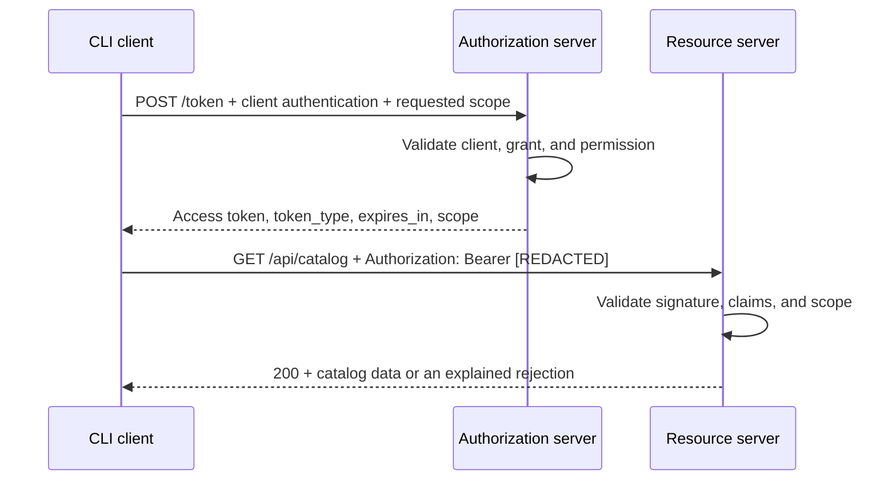

# Lab 01: Client Credentials — Implementation Plan

Status: implemented locally on October 22, 2026. The user requested implementation
of this plan with tests and documentation. The complete example lives under
[labs/01-client-credentials](../../labs/01-client-credentials/README.md).
This plan records scope and acceptance; startup instructions and evidence are
in the lab README.

## Learning question and outcome

How does an application obtain access to a protected API on its own behalf,
and which checks belong to the authorization server and resource server?

The CLI client requests a token and uses it to read data.
Deliberate changes to credentials, scopes, and tokens produce understandable,
distinct rejections. The roles run as three separate processes, with protocol
steps visible in code.

The implementation request selects the learning mode for this lab:
a complete, runnable example that can be inspected and modified.

## Architecture

An independent npm package under `labs/01-client-credentials/` contains the three
applications. It needs neither other labs nor a shared monorepo framework.

| Component | Default address | Responsibility |
| --- | --- | --- |
| Authorization server | `http://127.0.0.1:9000` | `POST /token`: authenticate the client, validate grant/scope, issue an access token |
| Resource server | `http://127.0.0.1:9001` | `GET /api/catalog` and `GET /api/reports`: validate the token and enforce each route's scope |
| Client | CLI process without a listener | Request a token, call the API, show steps/results without secrets |

Ports and base URLs are configurable; default binding remains loopback.
Both servers may expose a small public `/health` endpoint for readiness,
without sensitive configuration output.

There is no user login, browser consent, or redirect in this flow.
Client Credentials is intended for confidential clients; this client acts
as a service. Reference:
[RFC 6749, section 4.4](https://www.rfc-editor.org/rfc/rfc6749.html#section-4.4).

## Technology choices

- **Runtime:** Existing Node.js `v22.23.2`, npm `10.9.8`, read locally on the
  planning date. Node 22 was still LTS according to the
  [release overview](https://nodejs.org/en/about/previous-releases).
  The lab uses this local runtime.
- **TypeScript and ES modules:** Strict configuration following the
  [project rules](../../rules/typescript.md). The compiler writes JavaScript
  under the lab's ignored `.tmp/build/` directory.
- **HTTP:** Express 5 for small, visible routes and bounded form request parsing.
  No complete OAuth server library that hides the grant flow being learned.
- **JWT/cryptography:** `jose` handles key generation, signing, and verification.
  The library owns cryptographic operations; the custom authorization server
  implements grant and scope decisions.
- **Client and tests:** Node `fetch`, `node:test`, and `node:assert`;
  HTTP tests call actual listening servers. No extra test-server service.
- **Tools:** Lab-local TypeScript, ESLint/typescript-eslint, and Prettier
  configuration. `check` validates types, style, and behavior.
  Compatible package versions are fixed in the package and lockfile.
  TypeScript 5.9.3 is compatible with typescript-eslint 8.72.0;
  ESLint 10.13.0 supports the installed Node version.

### Token format and trust

Short-lived JWT access tokens signed with `RS256` are valid for 60 seconds.
JWT is a lab format choice; OAuth2 does not require it.
A later lab with opaque tokens and introspection can demonstrate the alternative.
The JWT is signed and readable by its holder, not encrypted.

The token structure follows
[RFC 9068](https://www.rfc-editor.org/rfc/rfc9068.html):
`typ=at+jwt`, `iss`, `aud`, `sub`, `client_id`, `iat`, `exp`, `jti`,
and `scope`. In this lab, `sub` identifies the client application.
Issuer and audience are fixed configuration values, not unchecked request input.

| Material | Required by |
| --- | --- |
| Client ID and client secret | Client and its registration at the authorization server |
| Private signing key | Authorization server |
| Public verification key, expected issuer/audience | Resource server |
| Access token | Client for API calls; resource server for validation |

The resource server loads its public key from explicit local configuration.
It needs neither the client secret nor private signing key and does not contact
the authorization server to validate JWTs. A valid token therefore keeps working
until expiry after the authorization server stops. This also demonstrates
the limits of immediate revocation.

These responsibilities are application boundaries on one development computer;
the processes do not receive operating-system sandboxes.

## Concrete protocol contract

### Client authentication and token issuance

- Registered service `lab01-client` may request `catalog:read` and `reports:read`.
  Omitting `scope` grants the documented default `catalog:read`.
- The token request uses HTTP Basic for client authentication and
  `application/x-www-form-urlencoded` with `grant_type=client_credentials`.
  Credentials do not belong in URLs. Simultaneous authentication methods
  and duplicate protocol parameters are rejected.
- Requested scopes use exact, case-sensitive matching.
  Unknown or unauthorized scopes produce `invalid_scope`;
  permissions are not silently expanded.
- The response contains `access_token`, `token_type=Bearer`, `expires_in`,
  and the actual granted `scope`. No refresh token or ID token.
- Token responses have JSON content type, `Cache-Control: no-store`,
  and `Pragma: no-cache`. Errors use suitable OAuth codes.
- Input sizes are bounded; client secrets use a suitable library/runtime
  comparison function. A small, testable local token-request limit
  prevents unlimited authentication attempts.

`client_secret_basic` makes client authentication visible.
The issued token's `RS256` signature is independent of that authentication.
Asymmetric client authentication such as `private_key_jwt` or mTLS belongs
to a later lab.

### API access

- `GET /api/catalog` requires `catalog:read`; `GET /api/reports` requires
  `reports:read`. Both return small synthetic datasets; no database or
  domain write operation is needed.
- The API accepts Bearer tokens in the Authorization header. Before access,
  it checks the algorithm allowlist, signature, token type, required claim types,
  expected issuer/audience, and time conditions. It then checks the required
  scope token separately.
- The client treats the token value as an opaque string. It validates the HTTP
  token response shape and uses the token in memory. An optional explanation
  of JWT structure does not make token contents a client authorization decision.
- API errors distinguish invalid authentication from insufficient scope and
  return the applicable `WWW-Authenticate` challenge.

The [protocol rules](../../rules/protocols.md) and
[web security rules](../../rules/web-security.md) also apply.
Local token structure and key provisioning do not establish full standards compliance.

## Files and responsibilities

The following files are implemented. Additional configuration and startup
helpers keep protocol decisions visible.

| Path under `labs/01-client-credentials/` | Behavior owner |
| --- | --- |
| `package.json`, `package-lock.json`, `tsconfig.json` | Lab-local installation, compiler, named startup/check scripts |
| `eslint.config.mjs`, `.prettierrc.json` | Selected TypeScript conventions |
| `src/setup.ts` | Generate synthetic client registration and local keys; preserve existing data by default |
| `src/authorization-server.ts` | Token endpoint, client authentication, grant/scope checks, issuance, error mapping |
| `src/resource-server.ts` | Protected routes, JWT/claim validation, scope authorization |
| `src/client.ts` | Request a token, call the selected API route, print clear redacted results |
| `src/contracts.ts` | Public data contracts and general protocol types only; no shared secrets or private keys |
| `test/authorization-server.test.ts` | Token endpoint and rejections over HTTP |
| `test/resource-server.test.ts` | Token validation and separate scope decisions |
| `test/flow.test.ts` | Three-process interaction, client errors, AS outage after token issuance |
| `README.md` | Startup, sequence, experiments, sources, simplifications, actual results |

Modules read only the configuration their role needs.
Small additional helpers may clarify responsibility without creating
a general framework for future labs.

## Implementation steps

1. **Lab scaffold and local configuration.** Set up the package/tools and generate
   keys and a client secret under the lab's ignored `.local/`.
   Setup preserves existing data. Explicit reset affects only lab data;
   restart servers after replacing keys.
2. **Authorization server.** Implement the token request and rejections first,
   verifying them over HTTP. Explain what the client proves and why the AS
   grants particular scopes.
3. **Resource server.** Validate tokens with the public key and expose both
   scope decisions. Incorrectly signed tokens and valid tokens lacking
   permission produce different rejections.
4. **CLI client and complete flow.** Connect token issuance and API access.
   Allow scope and target route changes. Explain network/OAuth failures without
   printing secrets. Set time limits, reject token/API redirects, and exit
   unsuccessfully when requests fail.
5. **Experiments and evidence.** Verify three real processes, add the AS outage
   experiment, and complete the README with reproducible steps and actual results.

Each step can be explained and tried independently.
Already requested work does not need approval again after every step.

## Acceptance and test cases

Keep other conditions valid when testing a rejection so its responsible check
is clear. Malformed claim fixtures are created only in tests;
there is no public debug token endpoint.

| Experiment | Expected result | Responsible component |
| --- | --- | --- |
| Valid client, `catalog:read`, then read catalog | Token 200; API 200 with data | All three |
| Token with only `catalog:read`, then read reports | 403 `insufficient_scope` with required scope in challenge | Resource server |
| Token with `reports:read`, then read reports | 200 | AS and resource server |
| Incorrect secret or unknown client ID | 401 `invalid_client`, Basic challenge, no token | Authorization server |
| Request `catalog:delete` | 400 `invalid_scope`, no token | Authorization server |
| Missing grant, duplicate parameters, or incorrect request format | 400 `invalid_request` with valid client authentication | Authorization server |
| Unsupported grant | 400 `unsupported_grant_type` | Authorization server |
| Token-request budget exceeded | 429 with documented retry hint | Authorization server |
| Missing Bearer token | 401 with Bearer challenge and no misleading `invalid_token` error | Resource server |
| Tampered, incorrectly signed, or expired token | 401 `invalid_token` | Resource server |
| Correct signature but incorrect issuer/audience/type or invalid required claims | 401 `invalid_token` | Resource server |
| Compare response/token scopes and inspect headers | No permission expansion; token response is not cacheable | Authorization server |
| Stop AS after issuance; reuse valid token | API remains 200 until expiry; no online AS check | Resource server |
| Unreachable server or redirected request | Bounded, understandable client failure; no secrets in output | Client |

Time-dependent rejections use a controllable verification clock or deliberately
expired tokens; tests do not wait a minute.
HTTP tests use free ports and isolated temporary data. The process test launches
compiled programs and reliably cleans up its own processes.

Scripts `build`, `setup`, `start:as`, `start:rs`, `client`, and `check`
exist and are documented in the lab README.
`check` includes type/style checks and relevant HTTP/process tests.
The tests were executed locally; final verification evidence lives in the lab README.

## Intentional limitations

- Loopback-only HTTP is a documented learning simplification relative to
  TLS-protected OAuth connections. Publication is not authorized.
- Manually provisioned public keys keep the first lab small.
  JWKS, discovery, key rotation, introspection, and active token revocation
  are outside this implementation. Bearer tokens remain reusable until expiry;
  `jti` alone does not prevent replay.
- User accounts, browser login, consent, OIDC, PKCE, refresh tokens, SSO, SAML,
  and real Okta/Trimble integrations belong to later labs.
- No database, container platform, or deployment outside the local development
  computer. Keep functional tokens and secrets out of shared logs and examples.

## Implementation sources

- [RFC 6749: Client Credentials](https://www.rfc-editor.org/rfc/rfc6749.html#section-4.4),
  [client authentication](https://www.rfc-editor.org/rfc/rfc6749.html#section-2.3.1),
  and [token responses](https://www.rfc-editor.org/rfc/rfc6749.html#section-5).
- [RFC 6750: Bearer use and errors](https://datatracker.ietf.org/doc/html/rfc6750#section-3).
- [RFC 9700: OAuth security practice](https://www.rfc-editor.org/rfc/rfc9700.html).
- [RFC 9068: JWT Access Tokens](https://www.rfc-editor.org/rfc/rfc9068.html).
- [OWASP OAuth2 Cheat Sheet](https://cheatsheetseries.owasp.org/cheatsheets/OAuth2_Cheat_Sheet.html).
- [jose: signing, verification, and key management](https://github.com/panva/jose).
- [Express 5 API](https://expressjs.com/en/5x/api/) and
  [Node test runner](https://nodejs.org/api/test.html).
