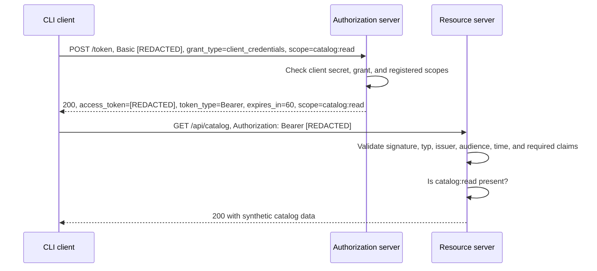

# Lab 01: Client Credentials

How does an application access an API on its own behalf? This complete learning
example shows authorization-server and resource-server decisions through three
separate TypeScript processes. There is no user login.

## Start in PowerShell

Requires Node.js 22 from 22.23.2 onward, with npm. From the project root:

```powershell
Set-Location labs/01-client-credentials
npm.cmd ci
npm.cmd run build
npm.cmd run setup
```

Setup generates a random client secret and an RSA key pair under `.local/`.
Repeating setup preserves existing files. Keep these files out of Git,
screenshots, and shared traces.

Open three terminals in the lab directory. Start the authorization server in
terminal 1:

```powershell
npm.cmd run start:as
```

Start the resource server in terminal 2:

```powershell
npm.cmd run start:rs
```

Run the client in terminal 3:

```powershell
npm.cmd run client
```

Expected redacted client output:

```text
1. POST http://127.0.0.1:9000/token — client_secret_basic; grant_type=client_credentials
2. Token received: Bearer, 60 s; scope=catalog:read. Token value stays in memory.
3. GET http://127.0.0.1:9001/api/catalog — Authorization: Bearer [REDACTED]
4. API 200: {"items":[{"id":"book-01","name":"OAuth2 handbook"}]}
```

Servers run until `Ctrl+C`. After code changes, run `npm.cmd run build` again
and restart affected processes. There is no automatic watch mode.
`npm.cmd run client -- --help` lists options.

## Roles and messages

| Role                      | Default address                                        | Responsibility                                                    |
| ------------------------- | ------------------------------------------------------ | ----------------------------------------------------------------- |
| Authorization server (AS) | `http://127.0.0.1:9000/token`                          | Authenticate the client, check grant/scope, issue an access token |
| Resource server (RS)      | `http://127.0.0.1:9001/api/catalog` and `/api/reports` | Validate the token, then enforce the route's scope                |
| CLI client                | No listener                                            | Request a token and use it as a Bearer token                      |

Both servers expose public `GET /health`, returning only `{"status":"ok"}`. All
listeners and client base URLs are restricted to `127.0.0.1`.



Token requests use `application/x-www-form-urlencoded`. `grant_type` is
`client_credentials`; optional `scope` defaults to `catalog:read`. Under RFC
6749 section 3.2, an empty `scope` is treated as omitted; an empty required
`grant_type` produces `invalid_request`. Unknown parameters are ignored;
duplicate parameters are rejected.

The registration also allows `reports:read`. Scopes are exact, case-sensitive
values. Unknown or unregistered scopes are rejected with `invalid_scope`.
Duplicate parameters and simultaneous client authentication through the header
and body produce `invalid_request`.

With `client_secret_basic`, the client ID and secret are individually
form-encoded, joined by a colon, and Base64-encoded in the Basic header. Base64
does not encrypt anything. The AS compares equal-length SHA-256 digests using
Node's `timingSafeEqual`. Token signing is a separate operation: the AS signs
with its private key, and the API verifies with the public key.

Successful token responses contain `access_token`, `token_type`, `expires_in`,
and `scope`, with `Cache-Control: no-store` and `Pragma: no-cache`. No refresh
token or ID token is issued.

## Token format and trust boundaries

The access token is an RS256 JWT signed using `jose`, with `typ=at+jwt` and the
following claims. These values are a schema, not a usable token:

```json
{
  "iss": "http://127.0.0.1:9000",
  "aud": "urn:oauth2-playground:lab01:api",
  "sub": "lab01-client",
  "client_id": "lab01-client",
  "iat": "<issuance time in Unix seconds, as a number>",
  "exp": "<iat + 60, as a number>",
  "jti": "<random UUID>",
  "scope": "catalog:read"
}
```

Here, `sub` identifies the service client. The client treats the access token as
an opaque string and only validates the token response shape. The RS validates
signature and claims before deciding scope. It accepts only RS256 with its
pinned public key and does not load key URLs from tokens. Required claims and
types are checked; this lab requires matching `sub` and `client_id`.
Verification uses no additional clock tolerance.

A signed JWT is readable by its holder, not encrypted. `jti` identifies the
token but does not prevent reuse by itself.

| File under `.local/` | Used by                                       |
| -------------------- | --------------------------------------------- |
| `registration.json`  | AS: client ID, secret, allowed/default scopes |
| `private-key.pem`    | AS: sign tokens                               |
| `public-key.pem`     | RS: verify tokens                             |
| `client.json`        | Client: its client ID and secret              |

Each role reads only its own files. The process test even starts the RS from a
directory containing only the public key. Shared local storage is a learning
simplification, not process isolation or production secret management. File
modes do not replace separate Windows ACLs.

## Experiments

Run these commands in terminal 3 while both servers are running. Each client
invocation requests a new token.

| Experiment                              | Command                                                         | Expected result and explanation                           |
| --------------------------------------- | --------------------------------------------------------------- | --------------------------------------------------------- |
| Read catalog                            | `npm.cmd run client`                                            | 200; the default scope is sufficient                      |
| Read reports without the required scope | `npm.cmd run client -- --resource reports`                      | 403 `insufficient_scope`; valid token, missing permission |
| Read reports with the required scope    | `npm.cmd run client -- --resource reports --scope reports:read` | 200                                                       |
| Request both scopes                     | `npm.cmd run client -- --scope "catalog:read reports:read"`     | 200; both scopes granted, catalog read                    |
| Unknown scope                           | `npm.cmd run client -- --scope catalog:delete`                  | 400 `invalid_scope` at the AS; no API call                |
| Stop AS, then start client              | `npm.cmd run client -- --timeout-ms 500`                        | Token endpoint failure and exit code 1                    |

To test an incorrect secret, change only `clientSecret` in the local
`client.json`, preserving `registration.json`. Expect 401 `invalid_client` with
a Basic challenge. Restore the original value locally from `registration.json`
without printing it, or regenerate all four files through reset.

To narrow the registration, remove `reports:read` from `allowedScopes` in the
local `registration.json` and restart the AS. Requesting that scope then
produces 400 `invalid_scope`, even though the API has the route.

Call the RS directly without a token:

```powershell
curl.exe -i http://127.0.0.1:9001/api/catalog
```

Expect 401 with `WWW-Authenticate: Bearer realm="lab01-api"`. Missing
authentication produces no `invalid_token` error in the challenge. Invalid or
expired tokens produce 401 `invalid_token`. Insufficient scope produces 403 with
`error="insufficient_scope"` and the required scope in the challenge. Tokens in
the `access_token` URL parameter are rejected with 400.

`flow.test.ts` requests a token, stops the AS process, then successfully uses
the token at the API. The RS validates locally without needing the AS. A
separate HTTP check advances the verification clock to exactly `exp` and
establishes rejection at that boundary without waiting a minute. The CLI
intentionally neither persists nor prints tokens; these experiments use
ephemeral test data. To run the focused offline experiment:

```powershell
npm.cmd run build
node --test .tmp/build/test/flow.test.js
```

The AS allows 60 token requests per 60-second window, including failed
authentication attempts. Further requests receive 429, the lab-specific
`rate_limited` code, and `Retry-After` in seconds. This is a shared local budget
with constant memory use; restarting the process resets it.

## Configuration and reset

Set these optional variables in each relevant terminal:

```powershell
$env:LAB_AS_URL = 'http://127.0.0.1:9100'
$env:LAB_RS_URL = 'http://127.0.0.1:9101'
```

The AS uses `LAB_AS_URL` for its listener and issuer. The RS needs the same
`LAB_AS_URL` as its expected issuer; `LAB_RS_URL` sets its listener. The client
uses both values. Alternatively, the client alone may target these addresses
through `--as-url` and `--rs-url`. Paths, queries, credentials, other hosts, and
HTTPS URLs are rejected in this exclusively local lab. Audience remains
`urn:oauth2-playground:lab01:api`.

`LAB_DATA_DIR` selects a different local configuration directory. The default is
the lab's `.local/`, independently of the Node process's working directory.
Relative `LAB_DATA_DIR` values resolve from the working directory. Keep such
data exclusively in ignored local directories.

For a reset, stop both servers, then run:

```powershell
npm.cmd run setup -- --reset
```

This replaces only the four named configuration files in the selected data
directory without deleting other files. Previous client credentials and tokens
no longer match the new configuration. Restart both servers afterward.
Incomplete setup is not overwritten without `--reset`.

## Read the code and verify

Start with `runClient` in `src/client.ts` for token issuance and API calls. Then
read `createAuthorizationServer` in `src/authorization-server.ts` for client,
grant, and scope checks and token issuance. In `src/resource-server.ts`,
`authorize` separates token validation from the scope decision.
`configuration.ts`, `runtime.ts`, and `setup.ts` keep file access and startup
outside protocol decisions. Public contracts in `contracts.ts` contain no
secrets.

```powershell
npm.cmd run check
```

`check` runs strict typechecking, type-aware ESLint, Prettier checks, build, and
Node's test runner. Individual steps: `typecheck`, `lint`, `format:check`,
`build`, and `test`; `format` applies formatting. The lockfile fixes dependency
versions. Build and tests write only under `.tmp/`. Tests use free loopback
ports and their own temporary configurations; the normal `.local/` directory is
not changed.

HTTP tests use actual listeners. They check valid requests, registered scope
boundaries, incorrect client credentials, duplicate/malformed requests, size
limits, and rate limiting. RS tests cover tampered, incorrectly signed, expired,
and correctly signed tokens with invalid claims. CLI process tests cover
success, error codes, timeouts, rejected redirects, and redacted output,
including malicious error responses.

Verification on October 22, 2026, on Windows with Node.js `v22.23.2` and npm
`10.9.8`: `npm.cmd run check` completed with exit code 0; 59 tests including
subtests passed, with none failed or skipped. Typecheck, ESLint, Prettier, and
build also passed. The integration test ran AS, RS, and client as separate Node
processes and terminated them afterward.

The normal `npm.cmd run setup` was also run twice: first created, then
preserved. Git exclusions for all four runtime files, build output, and
`node_modules` were checked. Versions: TypeScript `5.9.3`, Express `5.3.0`,
`jose` `6.2.13`, ESLint `10.13.0`, typescript-eslint `8.72.0`, and Prettier
`3.9.10`.

Checks are local and focused, not a complete conformance or penetration test.
There is no browser flow to verify.

## Intentional simplifications and sources

Loopback HTTP makes messages visible in this experiment. External OAuth
connections require TLS. This lab is not published. Client secrets belong in
confidential clients, not shipped browser code. Short token lifetimes and local
rate limiting bound the experiment; production secret management and distributed
abuse protection are not included.

The structure follows RFC 9068 without establishing full standards compliance.
Public keys are provisioned locally; there is no discovery, JWKS, key rotation,
introspection, or active token revocation. A valid Bearer token can be reused
until expiry. User login, consent, OIDC, PKCE, refresh tokens, SSO, SAML, and
real Okta/Trimble integrations belong to later labs.

- [RFC 6749: client authentication](https://www.rfc-editor.org/rfc/rfc6749.html#section-2.3.1),
  [Client Credentials](https://www.rfc-editor.org/rfc/rfc6749.html#section-4.4),
  and [token responses](https://www.rfc-editor.org/rfc/rfc6749.html#section-5).
- [RFC 6750: Bearer use and errors](https://datatracker.ietf.org/doc/html/rfc6750#section-3).
- [RFC 9068: JWT access token validation](https://www.rfc-editor.org/rfc/rfc9068.html#section-4).
- [RFC 9700: OAuth security practice](https://www.rfc-editor.org/rfc/rfc9700.html).
- [OWASP OAuth2](https://cheatsheetseries.owasp.org/cheatsheets/OAuth2_Cheat_Sheet.html),
  [REST Security](https://cheatsheetseries.owasp.org/cheatsheets/REST_Security_Cheat_Sheet.html),
  and
  [Logging](https://cheatsheetseries.owasp.org/cheatsheets/Logging_Cheat_Sheet.html):
  input limits, authorization, and keeping credentials out of logs.
- [jose](https://github.com/panva/jose),
  [Express 5](https://expressjs.com/en/5x/api/),
  [Node test runner](https://nodejs.org/api/test.html).

Formatting and strict TypeScript settings follow the
[project conventions](../../rules/typescript.md).
